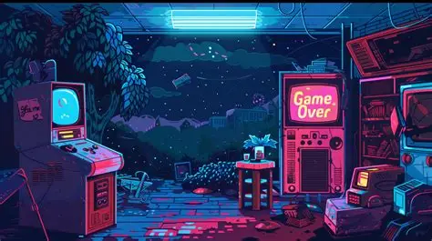

# MS - Grandma (Cyber Speed Typing Game)

A fast-paced, retro typing test game built with HTML, CSS, and JavaScript. Test your keyboard speed and accuracy against a 60-second countdown timer before Grandma catches you!



## Features

* **Curated Word Engine:** Over 200 coding terms, tech slang, and sci-fi action words to test your typing range.
*  **60-Second Countdown:** Real-time timer and score counter.
*  **Instant Matching:** Automatic word verification on typing with case-insensitive upper-casing.


##  Project Structure

```
├── index.html     # Main markup.
├── style.css      # Custom styling, fonts.
├── script.js      # Core game logic.
├── icon.jpg       # Custom tab favicon.
├── OIP.webp       # arcade background image
└── README.md      # Project documentation.
```

## How to Play

* Open `index.html` in any web browser.
* Click the **Start Game** button to unlock the input box and start the 60-second timer.
* Type the highlighted word exactly as shown.
* Each correct word adds **+1 Score** and instantly loads the next target word.
* Aim for the highest score before the clock reaches zero!
* You can also play by clicking on link : [GAME!](https://msdatahub58.github.io/MS-Grandma/)


## How it Fulfills Grandma's Demands

* **Speed & Agility:** Grandma loves fast typing to stay sharp. This game challenges users to type words quickly and accurately under a 60-second timer.
* **Aesthetic:** Styled with a dark and aesthetic interface, custom neon glow, and retro arcade vibe (`OIP.webp`) to match Grandma's futuristic tech setup.
* **Entertainment:** Keeps Grandma entertained, focused, and on her toes with real-time score tracking and an interactive challenge box.


## Tech Stack

* **HTML5** (structure)
* **CSS3** (Layout, custom variables)
* **JavaScript** (Core game logic)
* **FontAwesome** (Icons)

---

###  Author

Crafted by **shabi** | Handcrafted for **MS Hub**. 
